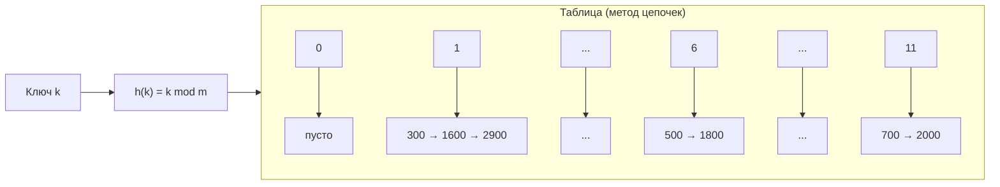
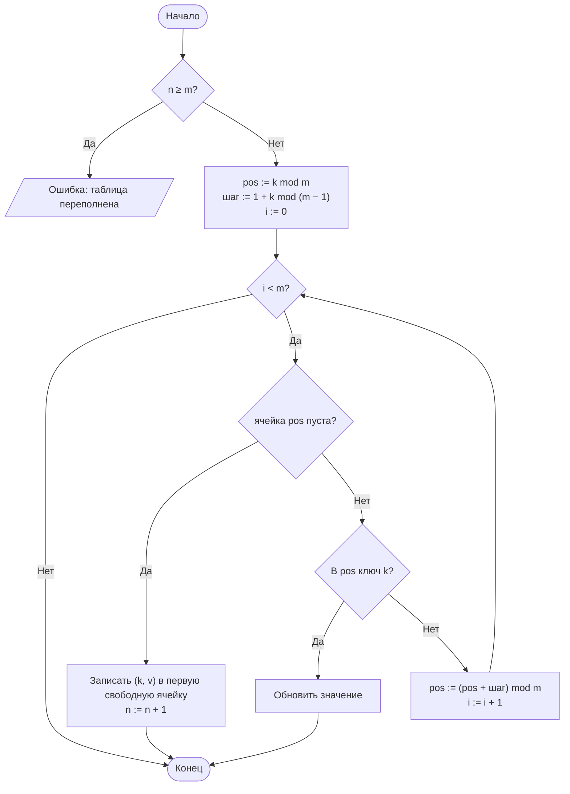

# Лабораторная работа № 5. Хеширование и экспериментальное исследование методов разрешения коллизий

**Дисциплина:** Теория алгоритмов  
**Направление подготовки:** 38.03.05 «Бизнес-информатика»  
**Выполнила:** Кугушева Арина, группа БИ2-1  
**Вариант:** 13

| Файл | Назначение |
|---|---|
| `README.md` | описание работы, разбор кода для защиты, результаты и выводы (этот файл) |
| `lab5_variant13.py` | программа с подробными комментариями: хеш-таблицы, эксперименты, самотесты |
| `report_lab5_variant13.pdf` | отчёт с титульным листом, схемами, листингом, таблицами и графиками |
---

## 1. Цель работы и задание варианта

**Цель работы:** изучить принципы хеширования как способа организации данных с временем доступа $O(1)$ в среднем, реализовать хеш-таблицу и экспериментально исследовать влияние хеш-функции и коэффициента заполнения на её производительность.

| Параметр | Значение |
|---|---|
| Тип ключей | целые числа, кратные 100 |
| Хеш-функция | метод деления, $h(k)=k \bmod m$ |
| Разрешение коллизий | метод цепочек и двойное хеширование |
| Число элементов $n$ | 30 000 |
| Размер таблицы $m$ | 49 999 (простое число) |
| Коэффициент заполнения | $\alpha=n/m\approx0{,}600$ |
| Дополнительное задание | В6 — кластеризация при линейном пробировании: распределение длин непрерывных занятых участков при разных $\alpha$ |

## 2. Хеш-функция и способы разрешения коллизий

**Метод деления.** $h_1(k)=k \bmod m$. Размер $m=49\,999$ — простое число. Это важно: ключи кратны $100=2^2\cdot5^2$, и если бы $m$ имел общие делители со 100, остатки занимали бы лишь малую часть ячеек (проверено в эксперименте, раздел 7).

**Метод цепочек.** Каждая ячейка таблицы хранит список пар (ключ, значение); ключи с одинаковым хешем лежат в одном списке. Средняя трудоёмкость поиска $\Theta(1+\alpha)$, допустимо $\alpha>1$.

**Двойное хеширование.** Все элементы лежат прямо в массиве. При занятой ячейке проверяется следующая с шагом, зависящим от ключа: $h_i(k)=(h_1(k)+i\cdot h_2(k)) \bmod m$, где $h_2(k)=1+(k \bmod (m-1))$. Шаг не равен нулю (прибавлена единица) и, так как $m$ простое, взаимно прост с $m$ — проба обходит все ячейки. Ключи с одинаковым $h_1$, но разным шагом идут по разным траекториям, поэтому кластеров нет. $\alpha<1$.

**Удаление при открытой адресации** выполняется с пометкой «удалено» (DELETED): простое обнуление ячейки разорвало бы последовательность проб.

## 3. Схема структуры данных



Пример при $m=13$ (изображение двойного хеширования с траекторией проб — в PDF, рис. 1). Ключ 2000: $h_1=11$, $h_2=1+2000 \bmod 12=9$; пробы: ячейка 11 (занята ключом 700) → $(11+9) \bmod 13=7$ (занята 1800) → $(7+9) \bmod 13=3$ (свободна).

### Блок-схема вставки при двойном хешировании



## 4. Разбор программы (для защиты)

Файл `lab5_variant13.py` разбит на восемь частей, каждая подробно прокомментирована.

| Часть | Что в ней | Главная мысль |
|---|---|---|
| 1. Константы | $N$, $M$, шаг ключей 100, seed 42 | seed делает запуски воспроизводимыми |
| 2. Хеш-функции | `hash_division`, `hash_step`, `hash_bad` | $h_1=k\bmod m$; шаг $h_2=1+k\bmod(m-1)$ никогда не равен 0 |
| 3. `ChainHashTable` | список списков; `insert`, `search`, `delete` | проба = одно сравнение с элементом цепочки |
| 4. `OpenHashTable` | массив ключей с метками `EMPTY` и `DELETED`; режимы `double` и `linear` | линейное пробирование — то же двойное, но шаг всегда 1 |
| 5. Измерения | `timed` (медиана 3 запусков), `fill`, `average_probes`, теоретические формулы | медиана защищает от случайных скачков времени |
| 6. Эксперименты | `experiment_main`, `_alpha`, `_clusters`, `_hash_quality`, `_delete` | каждый эксперимент — отдельная функция, возвращающая словарь результатов |
| 7. Самотесты | `check_correctness` | таблицы сравниваются с обычным `dict` на 3000 случайных операций |
| 8. Вывод | `print_report`, `save_plots`, `main` | параметры `--plots` и `--json` |

**Как работает поиск при двойном хешировании (метод `search`).** Берём $h_1$ и шаг. Смотрим ячейку `pos`: если в ней метка `EMPTY` — ключа нет (цепочка проб оборвалась); если лежит наш ключ — возвращаем значение; иначе (чужой ключ или метка `DELETED`) переходим к $(pos+шаг) \bmod m$. Каждая проверка ячейки увеличивает счётчик `probes`.

**Как работает вставка (`insert`).** Идём по той же траектории. Первую встретившуюся ячейку с меткой `DELETED` запоминаем (`first_free`), но продолжаем поиск до `EMPTY`, чтобы убедиться, что такого ключа ещё нет; затем пишем в запомненную (или найденную пустую) ячейку. Если ключ найден — обновляем значение.

**Три состояния ячейки** `EMPTY` / `DELETED` / ключ нужны, чтобы удаление не рвало цепочки проб (см. вопрос 8 в разделе «Ответы на контрольные вопросы»).

**Что такое «проба».** Для цепочек — одно сравнение ключа с элементом цепочки; для открытой адресации — просмотр одной ячейки массива. Среднее число проб = `probes / число запросов`.

**Кластеры (В6).** Метод `cluster_lengths` проходит по массиву слева направо и считает подряд идущие занятые ячейки; длины участков затем раскладываются по интервалам 1, 2, 3–4, 5–8, … 65 и более.

**Что можно показать на защите, запуская код:** `python lab5_variant13.py` (самотесты и все таблицы за ≈ 5 секунд); `python lab5_variant13.py --plots plots` (графики); изменить `N`, `M`, `ALPHAS` в начале файла и увидеть, как меняются результаты.

## 5. Листинг программы

Полный текст — в файле [`lab5_variant13.py`](lab5_variant13.py) и в PDF-отчёте.

```bash
python lab5_variant13.py                       # все эксперименты
python lab5_variant13.py --plots plots         # + графики (нужен matplotlib)
python lab5_variant13.py --json results.json   # + результаты в JSON
```

## 6. Результаты измерений

Среда: Linux, Python 3.13.18. Время — медиана из 3 запусков; ключи — случайные числа, кратные 100 (seed = 42); выполнено 10 000 успешных и 10 000 неуспешных запросов. Проба — одно сравнение (цепочки) или один просмотр ячейки (открытая адресация).

**Таблица 1. Результаты при $n=30 000$, $m=49 999$, $\alpha=0,600$**

| Реализация | Время вставки, с | Время поиска, с | Проб на успешный запрос | Проб на неуспешный запрос |
|---|---|---|---|---|
| Метод цепочек | 0,018 | 0,0029 | 1,28 | 0,57 |
| Двойное хеширование | 0,017 | 0,0047 | 1,51 | 2,48 |
| Встроенный `dict` (эталон) | 0,002 | 0,0006 | — | — |

Теория для $\alpha=0{,}6$: цепочки — 1,30 (успех) и 0,60 (неуспех); двойное хеширование — 1,53 и 2,50.

**Таблица 2. Распределение по ячейкам (метод цепочек)**

| Показатель | Значение |
|---|---|
| Средняя длина цепочки ($\alpha$) | 0,60 |
| Максимальная длина цепочки | 5 |
| Пустых ячеек | 27 191 из 49 999 (54,4 %) |
| Теоретическая доля пустых $e^{-\alpha}$ | 54,9 % |
| Различных значений $h_1$ среди ключей | 22 808 |
| Различных значений шага $h_2$ | 17 625 |

**Таблица 3. Среднее число проб в зависимости от $\alpha$ (опыт / теория)**

| $\alpha$ | Цепочки, успех | Цепочки, неуспех | Двойное, успех | Двойное, неуспех | Линейное, успех | Линейное, неуспех |
|---|---|---|---|---|---|---|
| 0,10 | 1,05 / 1,05 | 0,09 / 0,10 | 1,05 / 1,05 | 1,10 / 1,11 | 1,05 / 1,06 | 1,11 / 1,12 |
| 0,30 | 1,14 / 1,15 | 0,29 / 0,30 | 1,18 / 1,19 | 1,40 / 1,43 | 1,20 / 1,21 | 1,49 / 1,52 |
| 0,50 | 1,23 / 1,25 | 0,49 / 0,50 | 1,36 / 1,39 | 2,01 / 2,00 | 1,47 / 1,50 | 2,46 / 2,50 |
| 0,70 | 1,34 / 1,35 | 0,67 / 0,70 | 1,69 / 1,72 | 3,30 / 3,33 | 2,11 / 2,17 | 5,79 / 6,06 |
| 0,90 | 1,43 / 1,45 | 0,85 / 0,90 | 2,59 / 2,56 | 10,20 / 10,00 | 5,28 / 5,50 | 46,34 / 50,50 |
| 0,95 | 1,44 / 1,48 | 0,91 / 0,95 | 3,15 / 3,15 | 20,47 / 20,00 | 9,50 / 10,50 | 150,89 / 200,50 |

График с теоретическими кривыми — в PDF-отчёте (рис. 2); линейное пробирование добавлено для сравнения и задания В6.

## 7. Дополнительные эксперименты: качество хеш-функции и удаление

**Таблица 4. Метод цепочек, $n=3000$ ключей, разные хеш-функции**

| Хеш-функция | Занято ячеек | Макс. цепочка | Проб на запрос |
|---|---|---|---|
| k mod 49 999 (m простое) | 2 913 | 3 | 1,03 |
| k mod 50 000 (m не простое) | 498 | 15 | 4,03 |
| k mod 10 (плохая) | 1 | 3 000 | 1501,04 |

**Удаление.** Три ключа 100, 1200, 2300 образуют цепочку проб в таблице $m=11$ (все дают $h=1$). Удаляем первый и ищем третий: с пометкой DELETED — найден, с простым обнулением — не найден.

## 8. Результат дополнительного задания В6: кластеризация при линейном пробировании

Для каждого $\alpha$ вставлено $\alpha m$ ключей в таблицу с линейным пробированием ($h_i=(h_1+i) \bmod m$) и измерены длины непрерывных занятых участков. Для сравнения те же ключи вставлены двойным хешированием. Для случайного размещения средняя длина участка равна $1/(1-\alpha)$.

**Таблица 5. Кластеры при линейном пробировании и двойном хешировании**

| $\alpha$ | Участков (лин. / дв.) | Средняя длина (лин. / дв.) | Максимум (лин. / дв.) | $1/(1-\alpha)$ |
|---|---|---|---|---|
| 0,30 | 9 153 / 10 497 | 1,64 / 1,43 | 16 / 9 | 1,43 |
| 0,50 | 9 927 / 12 423 | 2,52 / 2,01 | 36 / 18 | 2,00 |
| 0,70 | 7 656 / 10 462 | 4,57 / 3,35 | 94 / 25 | 3,33 |
| 0,90 | 2 999 / 4 465 | 15,00 / 10,08 | 554 / 76 | 10,00 |
| 0,95 | 1 578 / 2 375 | 30,10 / 20,00 | 1701 / 148 | 20,00 |

**Таблица 6. Распределение длин участков при линейном пробировании (число участков)**

| Длина участка | $\alpha=0,30$ | $\alpha=0,50$ | $\alpha=0,70$ | $\alpha=0,90$ | $\alpha=0,95$ |
|---|---|---|---|---|---|
| 1 | 5 854 | 4 704 | 2 639 | 743 | 375 |
| 2 | 1 930 | 2 082 | 1 286 | 400 | 225 |
| 3–4 | 1 082 | 1 789 | 1 490 | 485 | 225 |
| 5–8 | 272 | 1 041 | 1 143 | 445 | 209 |
| 9–16 | 15 | 272 | 759 | 333 | 163 |
| 17–32 | 0 | 38 | 271 | 263 | 139 |
| 33–64 | 0 | 1 | 65 | 170 | 98 |
| 65 и более | 0 | 0 | 3 | 160 | 144 |

Графики (гистограммы для линейного и двойного) — в PDF-отчёте (рис. 3).

## 9. Выводы

1. При n = 30 000, m = 49 999 (α = 0,60) метод цепочек делает в среднем 1,28 проб на успешный поиск (теория 1 + α/2 = 1,30), двойное хеширование — 1,51 (теория (1/α)·ln(1/(1 − α)) = 1,53). Эксперимент совпадает с теорией с точностью до сотых.
2. Цепочки устойчивее к росту α: при α = 0,95 успешный поиск требует 1,44 проб, а двойное хеширование — 3,15, линейное пробирование — 9,50. При неуспешном поиске различие ещё больше: 0,91, 20,5 и 151 проб. Для двойного хеширования опыт подтверждает формулу 1/(1 − α): 10,2 против 10,0 при α = 0,9 и 20,5 против 20,0 при α = 0,95.
3. Длины цепочек подчиняются распределению Пуассона: пустых ячеек 54,4 % (теория e^−α = 54,9 %), средняя длина цепочки 0,60, максимальная — 5. Значительная доля ячеек пуста, а максимум заметно превышает среднее — различие между средним и худшим случаями.
4. В6. При линейном пробировании образуется первичная кластеризация: при α = 0,95 самый длинный непрерывный занятый участок содержит 1701 ячеек (средняя длина 30,1), тогда как при двойном хешировании с теми же ключами — 148 ячеек (средняя 20,0, что совпадает с теоретическим 1/(1 − α) = 20 для случайного размещения). При малом α (0,3) различие невелико — максимум 16 и 9. Кластеры растут из-за того, что каждый новый ключ, попавший в занятый участок, достраивает его справа и делает ещё более вероятным попадание следующих ключей.
5. Выбор размера таблицы критичен. Ключи кратны 100, поэтому при m = 50 000 (общий делитель 100) использовалось лишь 498 ячеек из 50000 против 2913 при простом m = 49 999 (n = 3000), а среднее число проб выросло с 1,03 до 4,03. Заведомо плохая h(k) = k mod 10 отправляет все ключи в одну ячейку: цепочка длиной 3000 и 1501 проб на запрос — вырождение в линейный поиск Θ(n).
6. Удалять из таблицы с открытой адресацией нужно с пометкой «удалено»: при простом обнулении ячейки последовательность проб разрывается, и ключ, лежавший дальше, перестаёт находиться (в эксперименте: «найден» при пометке DELETED, «не найден» при обнулении).
7. Встроенный dict быстрее собственной реализации: вставка в 7 раз для цепочек и в 7 раз для двойного хеширования, поиск в 8 раз для двойного хеширования. Причина — dict написан на C, а наш код выполняется интерпретатором Python (каждая проба — несколько байт-кодов). Собственная реализация имеет учебное назначение: она позволяет считать пробы и смотреть внутреннее устройство таблицы.
8. Хеш-таблица даёт среднее время поиска, вставки и удаления Θ(1), но не хранит ключи упорядоченно: запросы вида «все ключи от 10 000 до 50 000» и вывод по возрастанию неэффективны. Для них следует выбирать упорядоченный массив или сбалансированное дерево поиска.

## 10. Ответы на контрольные вопросы

**1. Почему прямая адресация неприменима к таким ключам, как ИНН или номер договора?**  
Для неё нужен массив с числом ячеек, равным числу возможных значений ключа. У 12-значного ИНН это 10¹² ячеек ради нескольких тысяч реальных записей — память тратилась бы впустую.

**2. Дайте определение коллизии. Почему коллизии неизбежны?**  
Коллизия — ситуация h(k₁) = h(k₂) при k₁ ≠ k₂. Ключей возможно намного больше, чем ячеек (число возможных ключей намного больше m), поэтому по принципу Дирихле какие-то разные ключи неизбежно получат одну ячейку. В нашем опыте (α = 0,60) непусты 46 % ячеек, и в 7192 случаях ключ попал в уже занятую ячейку.

**3. Перечислите требования к хеш-функции. Почему h(k) = k mod 10 плоха?**  
Требования: быстрое вычисление, равномерное распределение по ячейкам, зависимость от всех разрядов ключа. Функция k mod 10 даёт всего 10 значений и учитывает только последнюю цифру; для наших ключей (кратных 100) она всегда равна 0, и в опыте все 3000 ключей оказались в одной цепочке (1501 проб на запрос).

**4. Почему в методе деления размер таблицы рекомендуется брать простым числом?**  
Если m имеет общие делители с ключами, остатки k mod m принимают лишь малую часть значений. У нас ключи кратны 100; при m = 50 000 занято 498 ячеек из 50 000, при простом m = 49 999 — 2913 из 3000 возможных.

**5. Что такое коэффициент заполнения? Какие значения он может принимать при цепочках и при открытой адресации?**  
α = n/m — число хранимых элементов, делённое на число ячеек. При цепочках α может быть любым неотрицательным, в том числе больше 1 (это средняя длина цепочки). При открытой адресации все элементы лежат в массиве, поэтому α < 1.

**6. Объясните формулу C ≈ 1/(1 − α). Что происходит при α → 1?**  
Доля занятых ячеек равна α; проба неудачна с вероятностью α, значит число проб до свободной ячейки: 1 + α + α² + … = 1/(1 − α). При α = 0,5 это 2 пробы, при 0,9 — 10, при α → 1 число проб стремится к бесконечности. Опыт (двойное хеширование, неуспешный поиск): 10,2 при α = 0,9 и 20,5 при α = 0,95.

**7. Что такое первичная кластеризация и как с ней борются?**  
При линейном пробировании занятые ячейки образуют длинные непрерывные участки: ключ, попавший в участок, достраивает его, и вероятность попасть в него следующим ключам растёт. В опыте при α = 0,95 длиннейший участок — 1701 ячеек против 148 у двойного хеширования. Борьба: квадратичное или двойное хеширование, а также расширение таблицы до того, как α станет большим.

**8. Почему при открытой адресации нельзя просто обнулять ячейку при удалении?**  
Поиск останавливается на первой пустой ячейке. Если освободить ячейку из середины последовательности проб, элементы за ней перестают находиться. Поэтому ставят метку «удалено» (DELETED), на которой поиск продолжается. Это проверено в эксперименте experiment_delete.

**9. Что такое рехеширование? Почему вставка остаётся O(1) амортизированно?**  
Когда α превышает порог (обычно 0,75), создают таблицу вдвое большего размера и заново вставляют в неё все элементы — это Θ(n). Расширения происходят при размерах n, 2n, 4n, …, поэтому суммарная стоимость копирований n + n/2 + n/4 + … < 2n, то есть O(1) на одну вставку. В варианте 13 рехеширование не требуется (α = 0,6 < 0,75).

**10. Какие запросы к данным хеш-таблица выполнять не умеет? Какую структуру следует выбрать в этом случае?**  
Запросы по диапазону («все ключи от a до b») и вывод по возрастанию, поиск ближайшего значения: хеш-функция разбрасывает ключи без учёта порядка. Для таких задач подходят упорядоченный массив (поиск Θ(log n), вставка Θ(n)) или сбалансированное дерево поиска (всё за Θ(log n)).

