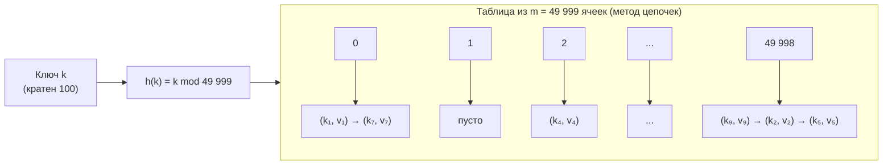
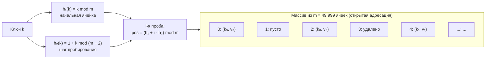
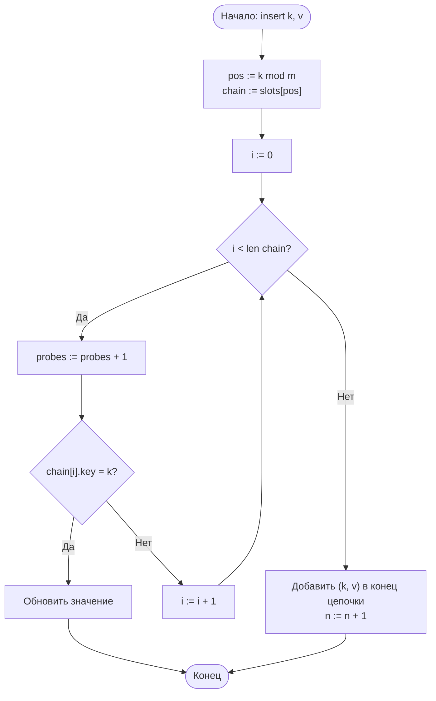
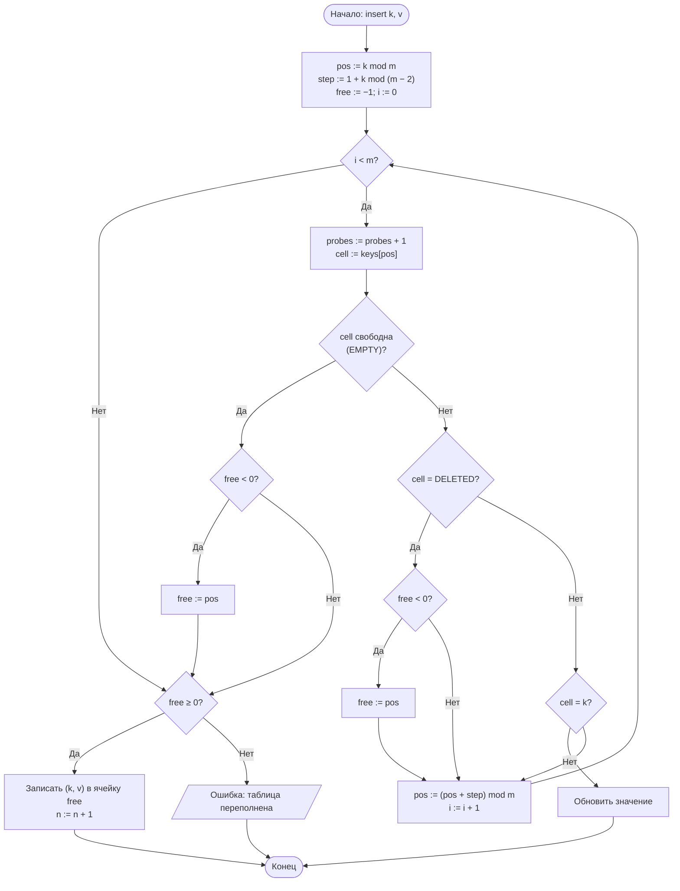
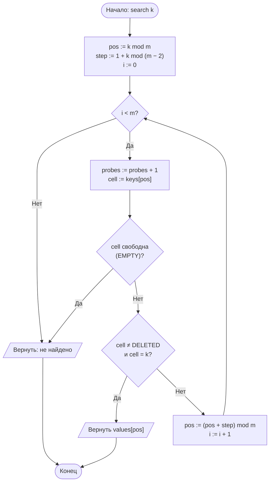

# Лабораторная работа № 5. Вариант 13

**Хеширование и экспериментальное исследование методов разрешения коллизий**

| | |
|---|---|
| **Дисциплина** | Теория алгоритмов |
| **Направление** | 38.03.05 «Бизнес-информатика» |
| **Выполнила** | Кугушева Арина Вячеславовна, группа БИ 2-1 |
| **Вариант** | 13 |

## Файлы

| Файл | Назначение |
|---|---|
| `lr5_variant13.py` | программа: алгоритмы, генерация данных, самопроверка, эксперименты, графики |
| `otchet_lr5_variant13.pdf` | отчёт по требованиям задания |
| `README.md` | этот файл |

## Запуск

```bash
pip install matplotlib
python lr5_variant13.py
```

Полный прогон занимает несколько секунд; программа печатает характеристики системы и таблицы результатов и сохраняет графики `lr5_plot_probes.png`, `lr5_plot_chains.png` и `lr5_plot_clusters.png`. Параметр `--json FILE` сохраняет результаты в JSON, `--show` показывает графики на экране.


## 1. Цель работы и задание варианта

**Цель работы:** изучить хеширование как способ организации данных со временем доступа O(1) в среднем, реализовать хеш-таблицу и экспериментально исследовать влияние хеш-функции и коэффициента заполнения на её производительность.

**Задание (вариант 13).** Реализовать хеш-таблицу для целых ключей, **кратных 100**, с хеш-функцией метода деления h(k) = k mod m (m — простое) и двумя способами разрешения коллизий: **методом цепочек** и **двойным хешированием**. Вставить n = 30 000 элементов в таблицу размера m = 49 999, измерить время вставки и поиска, среднее число проб, распределение длин цепочек; сопоставить собственную реализацию со встроенным `dict` и с теоретическими кривыми. Дополнительное задание **В6**: исследовать кластеризацию при линейном пробировании — построить распределение длин непрерывных занятых участков при разных коэффициентах заполнения.

| № | Тип ключей | Хеш | Коллизии | n | m | α = n/m | Доп. |
|---|---|---|---|---|---|---|---|
| 13 | целые кратные 100 | Д (деление) | Ц и Дв | 30 000 | 49 999 | 0,600 | В6 |

**Условия эксперимента.** Ключи — различные числа вида 100·j, j — случайное целое из [1; 10⁷) (генератор с фиксированным начальным значением 13). Выполняется по 10 000 успешных и 10 000 неуспешных запросов (во втором случае ключи кратны 100, но в таблице отсутствуют). Время вставки — медиана по 5 повторам построения таблицы, время запроса — медиана по 5 повторам серии. «Проба» — просмотр одной ячейки при открытой адресации и сравнение одного ключа при просмотре цепочки.

Кроме задания варианта выполнены общие пункты порядка работы: график числа проб в зависимости от α с теоретическими кривыми (α = 0,1…0,95), сравнение с хорошей и заведомо неудачной (m = 50 000, кратным 100) таблицей, проверка удаления с пометкой «удалено».


## 2. Хеш-функция и способы разрешения коллизий

**Метод деления.** h(k) = k mod m. Размер m = 49 999 — простое число (проверено: нет делителей до √49 999 ≈ 223,6). Это существенно именно для ключей, кратных 100: если бы m имело общий делитель d с числом 100, ключи 100·j занимали бы лишь m/d ячеек (при m = 50 000 — всего 500; см. раздел 6.2). Простое m, не делящее 100, обеспечивает использование всех ячеек.

**Метод цепочек.** Ячейка i хранит список пар (ключ, значение) с h(k) = i. Коэффициент заполнения α = n/m — средняя длина цепочки. Среднее число сравнений: при неуспешном поиске ≈ α, при успешном ≈ 1 + α/2; трудоёмкость Θ(1 + α), в худшем случае Θ(n). Допускается α > 1.

**Двойное хеширование.** Все элементы лежат в массиве; i-я проба для ключа k:

pos<sub>i</sub> = (h<sub>1</sub>(k) + i·h<sub>2</sub>(k)) mod m, h<sub>1</sub>(k) = k mod m, h<sub>2</sub>(k) = 1 + k mod (m − 2).

Шаг h<sub>2</sub> лежит в диапазоне [1; m − 2], зависит от ключа и, поскольку m простое, взаимно прост с m — последовательность проб обходит все ячейки. (Делитель m − 2 = 49 997 взят взаимно простым с 100, чтобы шаги ключей, кратных 100, не вырождались.) Теоретическое среднее число проб при равномерном хешировании: неуспешный поиск 1/(1 − α), успешный (1/α)·ln(1/(1 − α)). Обязательно α < 1.

**Линейное пробирование** (для задания В6): шаг равен 1. Оно приводит к первичной кластеризации — слиянию занятых участков в длинные кластеры. Оценки Кнута: неуспешный поиск ½(1 + 1/(1 − α)²), успешный ½(1 + 1/(1 − α)).

**Удаление.** В цепочке элемент просто удаляется из списка. При открытой адресации ячейка помечается специальной меткой «удалено» (tombstone): простое обнуление разорвало бы последовательности проб других ключей, проходящих через эту ячейку.

**Таблица 1. Теоретические оценки среднего числа проб при α = 0,60**

| Способ | Неуспешный поиск | Успешный поиск |
|---|---|---|
| Метод цепочек | 0,600 | 1,300 |
| Двойное хеширование | 2,500 | 1,527 |
| Линейное пробирование | 3,625 | 1,750 |


## 3. Схемы структуры данных и блок-схемы алгоритмов



*Рис. 1. Схема хеш-таблицы с методом цепочек*



*Рис. 2. Схема хеш-таблицы с открытой адресацией (двойное хеширование)*



*Рис. 3. Блок-схема вставки при методе цепочек*



*Рис. 4. Блок-схема вставки при двойном хешировании (с учётом меток «удалено»)*



*Рис. 5. Блок-схема поиска при двойном хешировании*


## 4. Листинг программы

Файл `lr5_variant13.py` (самодостаточный модуль с подробными комментариями: таблицы, генерация данных, измерения, самопроверка, эксперименты, графики). Запуск: `python lr5_variant13.py`; требуется matplotlib.

Полный текст программы — в файле [`lr5_variant13.py`](lr5_variant13.py).


## 5. Характеристики вычислительной системы

| Параметр | Значение |
|---|---|
| Процессор | Intel(R) Xeon(R) Processor @ 2.10GHz, 2 логических ядра |
| Оперативная память | 8 ГБ |
| Операционная система | Linux (Ubuntu 24.04) |
| Интерпретатор | Python 3.13.18 |
| Таймер | time.perf_counter() |

*Абсолютные значения времени зависят от системы; число проб, форма распределений и соотношения между реализациями должны сохраниться. Программа при запуске выводит характеристики системы автоматически.*


## 6. Результаты измерений

6.1. Основной эксперимент (n = 30 000, m = 49 999, α = 0,600)

**Таблица 2. Время и число проб (10 000 успешных и 10 000 неуспешных запросов)**

| Реализация | Вставка 30 000 ключей, мс | Успешн. запрос, мкс | Неуспешн. запрос, мкс | Проб усп., опыт | Проб усп., теория | Проб неусп., опыт | Проб неусп., теория |
|---|---|---|---|---|---|---|---|
| Метод цепочек | 28,61 | 0,40 | 0,33 | 1,298 | 1,300 | 0,592 | 0,600 |
| Двойное хеширование | 13,81 | 0,47 | 0,50 | 1,568 | 1,527 | 2,594 | 2,500 |
| Линейное пробирование | 13,36 | 0,45 | 0,63 | 1,723 | 1,750 | 3,621 | 3,625 |
| Встроенный `dict` (эталон) | 1,93 | 0,06 | 0,04 | — | — | — | — |

6.2. Распределение длин цепочек и выбор размера таблицы

**Таблица 3. Метод цепочек: длины цепочек при простом m = 49 999 в сравнении с законом Пуассона**

| Длина цепочки | 0 | 1 | 2 | 3 | 4 | 5 | 6 |
|---|---|---|---|---|---|---|---|
| Ячеек (опыт) | 27400 | 16560 | 4882 | 976 | 160 | 18 | 3 |
| Ячеек (Пуассон, теория) | 27439,7 | 16464,2 | 4939,3 | 987,9 | 148,2 | 17,8 | 1,8 |

**Таблица 4. Влияние размера таблицы на метод цепочек (те же 30 000 ключей, кратных 100)**

| Размер m | Занятых ячеек | Пустых ячеек | Макс. длина цепочки | Проб (успешный поиск) |
|---|---|---|---|---|
| 49 999 (простое) | 22 599 | 27 400 | 6 | 1,10 |
| 50 000 (кратно 100) | 500 | 49 500 | 84 | 10,94 |


*Рис. 6. Распределение длин цепочек: простое m = 49 999 (слева, с наложением закона Пуассона) и m = 50 000 (справа, логарифмическая шкала)*

6.3. Зависимость числа проб от коэффициента заполнения

**Таблица 5. Среднее число проб, опыт / теория (усреднение по трём наборам ключей, m = 49 999)**

| α | n | Линейное, неуспешн. | Линейное, успешн. | Двойное, неуспешн. | Двойное, успешн. |
|---|---|---|---|---|---|
| 0.1 | 5 000 | 1,11 / 1,12 | 1,06 / 1,06 | 1,11 / 1,11 | 1,05 / 1,05 |
| 0.3 | 15 000 | 1,51 / 1,52 | 1,22 / 1,21 | 1,43 / 1,43 | 1,19 / 1,19 |
| 0.5 | 25 000 | 2,48 / 2,50 | 1,50 / 1,50 | 2,04 / 2,00 | 1,39 / 1,39 |
| 0.7 | 34 999 | 5,96 / 6,06 | 2,18 / 2,17 | 3,48 / 3,33 | 1,75 / 1,72 |
| 0.9 | 44 999 | 53,11 / 50,50 | 5,97 / 5,50 | 10,77 / 10,00 | 2,67 / 2,56 |
| 0.95 | 47 499 | 220,20 / 200,50 | 10,31 / 10,50 | 20,97 / 20,00 | 3,33 / 3,15 |


*Рис. 7. Среднее число проб в зависимости от α: точки — опыт, штриховые линии — теория (логарифмическая шкала по оси ординат)*


## 7. Дополнительное задание В6: кластеризация при линейном пробировании

Для каждого значения α строилась таблица с n = α·m ключами (для α = 0,6 — ровно n = 30 000), после чего измерялись длины *кластеров* — непрерывных участков занятых ячеек массива. Для сравнения построено то же для двойного хеширования на тех же ключах. Если бы ячейки занимались независимо с вероятностью α, средняя длина кластера составила бы 1/(1 − α) — это значение приведено как ориентир.

**Таблица 6. Статистика кластеров**

| α | n | Способ | Число кластеров | Средняя длина | Ориентир 1/(1−α) | Макс. длина |
|---|---|---|---|---|---|---|
| 0.3 | 15 000 | линейное | 9014 | 1,66 | 1,43 | 12 |
|  |  | двойное | 10425 | 1,44 |  | 8 |
| 0.5 | 25 000 | линейное | 9839 | 2,54 | 2,00 | 34 |
|  |  | двойное | 12508 | 2,00 |  | 14 |
| 0.6 | 30 000 | линейное | 8972 | 3,34 | 2,50 | 45 |
|  |  | двойное | 11985 | 2,50 |  | 20 |
| 0.7 | 34 999 | линейное | 7517 | 4,66 | 3,33 | 94 |
|  |  | двойное | 10472 | 3,34 |  | 32 |
| 0.9 | 44 999 | линейное | 2969 | 15,16 | 10,00 | 746 |
|  |  | двойное | 4470 | 10,07 |  | 108 |

**Таблица 7. Число кластеров заданной длины**

| α | Способ | 1 | 2 | 3–4 | 5–8 | 9–16 | 17–32 | 33–64 | 65+ |
|---|---|---|---|---|---|---|---|---|---|
| 0.3 | линейное | 5700 | 1908 | 1093 | 290 | 23 | 0 | 0 | 0 |
|  | двойное | 7226 | 2233 | 885 | 81 | 0 | 0 | 0 | 0 |
| 0.5 | линейное | 4639 | 2110 | 1725 | 1007 | 318 | 39 | 1 | 0 |
|  | двойное | 6189 | 3227 | 2331 | 695 | 66 | 0 | 0 | 0 |
| 0.6 | линейное | 3644 | 1755 | 1654 | 1180 | 597 | 134 | 8 | 0 |
|  | двойное | 4664 | 2962 | 2881 | 1272 | 203 | 3 | 0 | 0 |
| 0.7 | линейное | 2514 | 1359 | 1359 | 1231 | 694 | 289 | 65 | 6 |
|  | двойное | 3006 | 2248 | 2678 | 1967 | 539 | 34 | 0 | 0 |
| 0.9 | линейное | 734 | 429 | 474 | 424 | 333 | 262 | 154 | 159 |
|  | двойное | 406 | 392 | 725 | 1023 | 1068 | 718 | 134 | 4 |


*Рис. 8. Распределение длин кластеров (логарифмические шкалы): линейное пробирование и двойное хеширование при α = 0,6; 0,7; 0,9*

Контроль удаления.

Из таблицы с n = 30 000 ключами удалено 6 000 ключей (20 %), затем проверялся поиск всех 24 000 оставшихся. При пометке «удалено» потерь нет: 0 (линейное) и 0 (двойное). При простом обнулении ячейки поиск не находит 2579 (10,7 %) оставшихся ключей при линейном пробировании и 2177 (9,1 %) при двойном хешировании — последовательность проб обрывается на «освобождённой» ячейке.


## 8. Выводы

1. **Измеренное число проб соответствует теории.** При α = 0,60 метод цепочек даёт 1,30 проб при успешном и 0,59 при неуспешном поиске (теория 1,30 и 0,60); двойное хеширование — 1,57 и 2,59 (теория 1,53 и 2,50); линейное — 1,72 и 3,62 (теория 1,75 и 3,63).

2. **Метод деления с простым m хорошо работает на ключах, кратных 100.** Длины цепочек подчиняются закону Пуассона (табл. 3: максимум 6, пустых ячеек 27 400 из 49 999, то есть 55 %, теория 55 %). При размере m = 50 000, имеющем общий делитель со ступенью ключей, используются лишь 500 ячеек, максимальная цепочка достигает 84, а число проб при успешном поиске возрастает с 1,10 до 10,94. Поэтому размер таблицы следует брать простым.

3. **Метод цепочек устойчивее к росту α, открытая адресация чувствительна к заполнению.** Число проб при неуспешном поиске растёт как 1/(1 − α) (двойное хеширование) и ≈ ½/(1 − α)² (линейное): при α = 0,9 опыт даёт 10,8 и 53,1 проб, при α = 0,95 — 21,0 и 220. Двойное хеширование при любых α не хуже линейного пробирования; для метода цепочек число сравнений растёт линейно по α. Именно поэтому таблицы открытой адресации расширяют при α ≈ 0,5–0,75.

4. **В6: линейное пробирование порождает кластеры.** Средняя длина кластера при линейном пробировании выше, чем при независимом заполнении ячеек (1/(1 − α)), и выше, чем при двойном хешировании: при α = 0,6 — 3,34 против 2,50 (ориентир 2,50), при α = 0,9 — 15,2 против 10,1 (ориентир 10,0). Кластеров меньше (8 972 против 11 985 при α = 0,6), а самые длинные намного длиннее: максимум 45 против 20 при α = 0,6 и 746 против 108 при α = 0,9. С ростом α длины растут быстрее, чем 1/(1 − α): распределение длин у линейного пробирования имеет «тяжёлый хвост» (рис. 8), а новый ключ, попавший в кластер, увеличивает его — «богатый богатеет».

5. **Кластеризация объясняет рост числа проб.** Ключ, хеш которого попал в длинный кластер, должен просмотреть почти весь кластер до его конца, а вероятность попасть в кластер пропорциональна его длине. Поэтому при малых α (≈ 0,1) линейное пробирование и двойное хеширование не различаются, а при α ≥ 0,5 неуспешный поиск при линейном пробировании заметно дороже (табл. 5). Двойное хеширование «рассеивает» ключи с разными шагами и кластеров практически не образует.

6. **Сравнение с dict и ограничения реализации.** Встроенный dict в 7–15 раз быстрее собственных таблиц при вставке (1,93 мс против 13,81–28,61 мс) и в 8–7 раз при поиске: он реализован на C, а интерпретируемый код тратит время на вызовы методов и работу со списками. Собственная реализация имеет учебное значение: она позволяет считать пробы и видеть цепочки и кластеры. Различия между самими таблицами по времени меньше различий по числу проб, так как стоимость пробы в Python велика и сопоставима со стоимостью вызова метода; метод цепочек медленнее при вставке из-за создания 49 999 списков и кортежей, но быстрее при неуспешном поиске.

7. **Удаление.** При открытой адресации нельзя обнулять ячейку: после удаления 20 % ключей поиск не находил 10,7 % (линейное) и 9,1 % (двойное) оставшихся ключей. Пометка «удалено» полностью устраняет проблему, ценой того, что «надгробия» удлиняют пробы, пока таблица не будет перестроена.

8. **Ограничение хеш-таблиц.** Ключи в таблице не упорядочены, поэтому запросы вида «все ключи из диапазона» или вывод по возрастанию требуют полного просмотра либо другой структуры (упорядоченный массив, дерево).


## 9. Список литературы

1. Кормен Т., Лейзерсон Ч., Ривест Р., Штайн К. Алгоритмы: построение и анализ. — 3-е изд. — М.: Вильямс, 2013. — Гл. 11.

2. Кнут Д. Э. Искусство программирования. Т. 3. Сортировка и поиск. — 2-е изд. — М.: Вильямс, 2017.

3. Седжвик Р., Уэйн К. Алгоритмы на Java. — 4-е изд. — М.: Вильямс, 2013. — Гл. 3.4.

4. Документация Python: встроенные типы, dict [Электронный ресурс]. — URL: https://docs.python.org/3/library/stdtypes.html#dict

